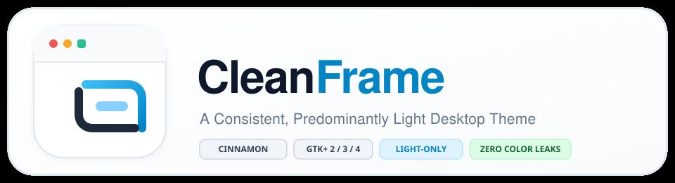
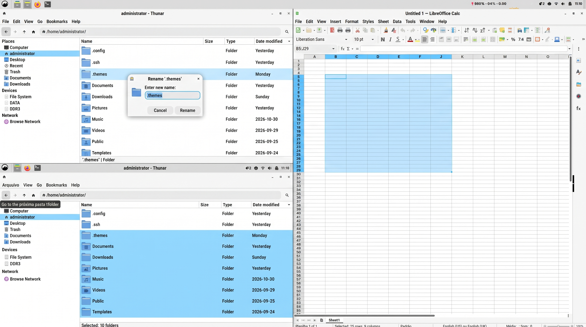
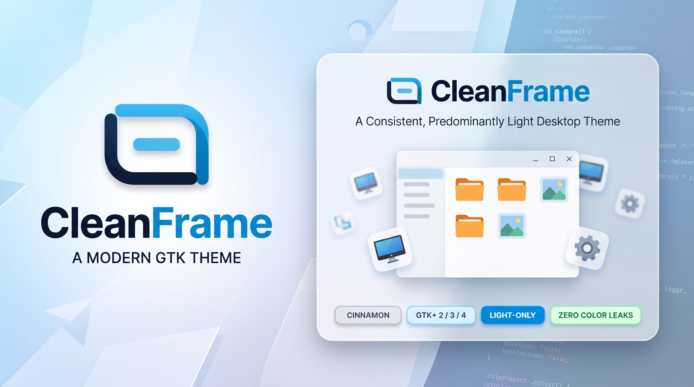
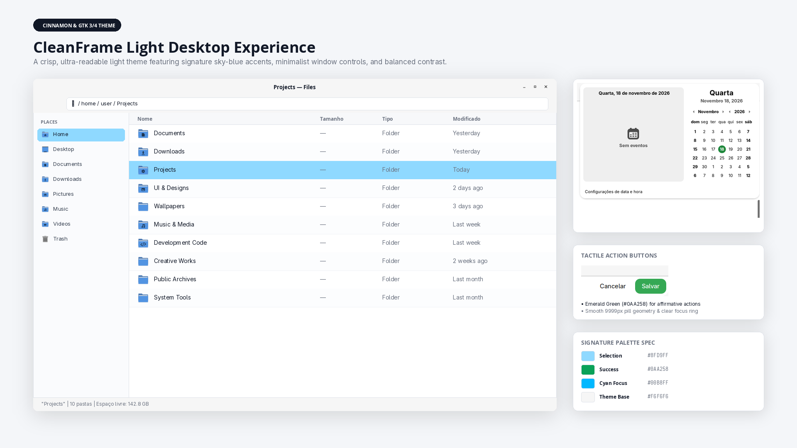
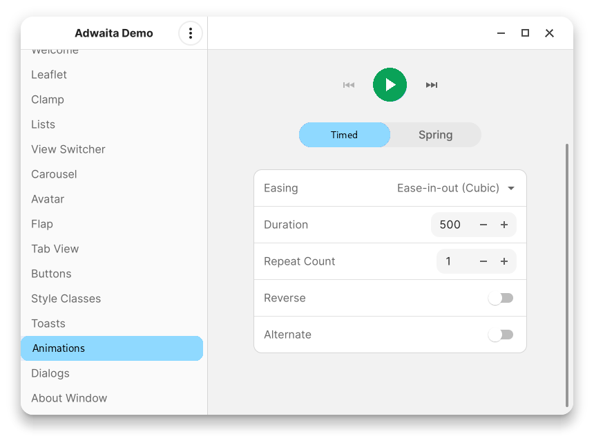

<p align="center">
  
</p>

<p align="center">
  <b>🇺🇸 English</b> | <b><a href="README.pt-BR.md">🇧🇷 Português</a></b>
</p>

# CleanFrame Theme

[](COPYING)
[](https://github.com/g00glelags/cleanframe/releases/latest)
[](https://www.opendesktop.org/p/2382045)
[](#principles)
[](#scope)
[](#test-status-and-environments)
[-blue.svg)](#verified-distributions)

CleanFrame is a **predominantly light** theme, carefully engineered with a primary focus on **Cinnamon** and the entire **GTK+ ecosystem** (GTK 2, GTK 3, and GTK 4).

The primary goal of CleanFrame is not to be flashy with heavy transparencies or harsh gradients that cause eye strain during daily work. The focus is to be **reliable, ergonomic, and crisp**: menus, popups, dialog boxes, text selections, input fields, terminal windows, and widgets remain clear, readable, and free of chromatic aberrations (*color leaks*) across as many interfaces as possible (GTK+, Cinnamon, Qt, Flatpak, Snap, and Electron wrappers).

---

### Maintainer / Official Links:
- **Author / Maintainer:** Marcos Sfair Mariani (`sfairmm`)
- **Email:** [g00gle.lags@gmail.com](mailto:g00gle.lags@gmail.com)
- **Telegram:** [@sfairmm](https://t.me/sfairmm)
- **OpenDesktop / Pling:** [https://www.opendesktop.org/p/2382045](https://www.opendesktop.org/p/2382045)
- **GitHub Repository:** [https://github.com/g00glelags/cleanframe](https://github.com/g00glelags/cleanframe)
- **Codeberg Mirror:** [https://codeberg.org/g00gle_lags/cleanframe](https://codeberg.org/g00gle_lags/cleanframe)

---

## Preview & Screenshots

<p align="center">
  
</p>

<p align="center">
  
</p>

<p align="center">
  
</p>

<p align="center">
  
</p>

---

## Test Status and Environments (Community Transparency)

To maintain full transparency with the community regarding our actual test coverage:

| Desktop Environment | Testing Level | Status & Notes |
| :--- | :--- | :--- |
| **Cinnamon** | 🟢 **Exhaustively Tested** | **Primary target environment.** Tested extensively in daily production use. Panel, applets, classic menus, modern Cinnamon 6+ (`.appmenu-*`), sidebar, calendar, window switcher, and CSD controls are fully polished. |
| **XFCE** | 🟡 **Tested on GTK+ Layer** | Verified on GTK+ applications and XFWM4 window decorations. Stable and consistent behavior. |
| **KDE Plasma** | 🟡 **Tested on GTK+ Layer** | Verified for consistent appearance across GTK+ applications running in Plasma sessions (colors, fonts, and selections). |
| **GNOME (Shell)** | ⚪ **Untested** | **Notice:** This theme has **never been tested on GNOME Shell by the author**. Although the codebase retains compilable SCSS targets inherited from upstream for GNOME Shell (40 to 49), visual behavior on pure GNOME Shell is not guaranteed. Community testing and feedback are welcome! |

### Verified Distributions

| Distribution | Status | Notes |
| :--- | :--- | :--- |
| **CachyOS / Arch Linux** | 🟢 **100% Functional** | Daily development and testing workstation (rolling release with cutting-edge packages). |
| **Linux Mint** | 🟢 **100% Functional** | Official reference environment for Cinnamon and the GTK ecosystem. |
| **Other Distributions** *(Fedora, Debian, Ubuntu, openSUSE, etc.)* | 🟡 **Likely Functional** | Since CleanFrame adheres to universal GTK 2/3/4 and Cinnamon standards, it is very likely to work smoothly. However, it has **not yet been officially tested** by the author. User reports and compatibility feedback are welcome! |

---

## Principles

- **Predominantly Light:** Focused strictly on light mode clarity, eliminating common dark/light hybrid glitches (such as light text on light backgrounds).
- **Visual Coherence over Eye Candy:** Prioritizing interface dependability over fragile aesthetic effects.
- **Legibility and Contrast First:** Menus, popups, and selection highlights are always sharp and easy to read.
- **Safe Fallback:** Providing clean, readable fallbacks when an application fails to inherit system themes automatically.
- **Documented Integrations:** Dedicated automation scripts for Qt, Flatpak, Snap, Terminals, and Electron.

## Scope

The repository provides:

- Base theme targets (Cinnamon, GTK 2 / 3 / 4, XFWM4, Metacity)
- Compatibility and integration scripts (Qt/GTK, Flatpak, Snap, Electron, terminal profiles)
- Troubleshooting tools and application-specific overrides (FileZilla wxWidgets safe-mode, LibreOffice Calc dedicated selection)

## Quick Installation

```bash
./install.sh
```

## Flatpak and Snap Presets

The installer can configure environment presets to ensure visual consistency across sandboxed applications.

```bash
# Flatpak (sets GTK_THEME and theme/config read permissions)
./install.sh --flatpak

# Snap (generates preset in ~/.config/environment.d)
./install.sh --snap

# Both
./install.sh --sandbox
```

Notes:
- `--flatpak` applies `flatpak override --user`.
- `--snap` creates `~/.config/environment.d/90-cleanframe-theme.conf` with `GTK_THEME=CleanFrame-Light`.
- For Snap, logging out and back into your session may be required to propagate environment variables.

## Community Integrations (Qt / Flatpak / Electron)

To achieve visual harmony in applications that do not inherit GTK themes automatically:

```bash
bash scripts/apply-community-integrations.sh
```

Examples:

```bash
# Qt/GTK integration only (without installing packages)
bash scripts/apply-community-integrations.sh --qt

# Generate selection CSS for Electron wrappers
bash scripts/apply-community-integrations.sh --electron

# Generate CSS for all known Electron app presets
bash scripts/apply-community-integrations.sh --electron --electron-all-known

# Enable CSS injection in Slack (standard + Flatpak), when supported
bash scripts/apply-community-integrations.sh --slack-interop
```

Important Considerations:
- Electron apps (Slack, Teams, web wrappers) do not automatically inherit GTK webview selection colors.
- CleanFrame generates CSS selection snippets, but the target app must support custom CSS or script injection.
- `teams-for-linux` natively supports `custom.css`; Slack may require `ssb-interop.js`.

## Known Limitations (Support Guidelines)

- **Qt:** Requires environment variables loaded in the user session (`~/.config/environment.d`), typically active after relogin.
- **Flatpak:** May require user overrides and file read permissions for custom theme paths.
- **Electron:** Custom styling depends on build-specific support for preload injection or custom stylesheets.
- Proprietary software may render internal widgets using custom canvas routines that bypass GTK styling.

## Dedicated LibreOffice Calc Variant

To preserve the system's global selection color while using a distinct highlight in Calc spreadsheets:

```bash
# 1) Install or update the base theme
./install.sh

# 2) Generate the dedicated CleanFrame-Light-Calc variant (selection #00b8ff)
./scripts/install-calc-theme-variant.sh

# 3) Launch Calc forcing the dedicated variant
./scripts/run-calc-with-theme.sh
```

Optional (custom color override):
```bash
CALC_SELECTION_BG='#00b8ff' ./scripts/install-calc-theme-variant.sh
```

## FileZilla (Safe Mode)

If FileZilla encounters visual rendering bugs (such as black drag-and-drop targets or distorted inline renaming):

```bash
./scripts/run-filezilla-safe.sh
```

Optional (test with your current active theme):
```bash
FILEZILLA_GTK_THEME='CleanFrame-Light' ./scripts/run-filezilla-safe.sh
```

## Packaging and Build for Community Distribution

To compile theme artifacts and generate release packages (`.tar.xz`, `.zip`) ready for community distribution (GitHub Releases, Gnome-Look / Pling):

```bash
# Compile theme artifacts into build/
make build

# Package release archives (.tar.xz and .zip) into dist/
make package
```

## Community Release Documents

Reference documents for testing, validation, and licensing compliance:

- `CREDITS.md` - Complete author attribution and upstream credits
- `COPYING` - Full GNU General Public License v3.0 text
- `docs/TEST_MATRIX.md` - Test matrix across GTK, Cinnamon, and Shell
- `docs/RELEASE_CHECKLIST.md` - Pre-release checklist
- `docs/LICENSE_AND_CREDITS.md` - Upstream licensing compliance notes

## License and Credits

CleanFrame is free software licensed under the **GNU General Public License v3.0 (GPL-3.0)**.

Maintained by **sfairmm** ([g00gle.lags@gmail.com](mailto:g00gle.lags@gmail.com)), respectfully derived from outstanding community projects:
- **Orchis Theme** by Vince Liuice ([@vinceliuice](https://github.com/vinceliuice))
- **Materia Theme** by nana-4 ([@nana-4](https://github.com/nana-4))
- **Firefox GNOME Theme** by Rafael Mardojai and Sai Kurogetsu
- **Adwaita / GNOME Shell** by GNOME Design Team / Red Hat, Inc.

### AI Assistance Credits

The development and refinement of CleanFrame were assisted by Artificial Intelligence models:
- **Codex (OpenAI) in 2025:** Assisted in the initial fork restructuring, isolation of dark mode rules, and SCSS stylesheet adaptations for unified light mode.
- **Gemini (Google DeepMind) in 2026:** Assisted in build pipeline stabilization, GTK4 CSS normalization engineering (GNOME Shell 40–49), automated visual audits, ecosystem integration scripts (Flatpak/Snap/Terminal/Electron), and community release packaging.

See [CREDITS.md](CREDITS.md) and [COPYING](COPYING) for complete licensing and legal notices.
