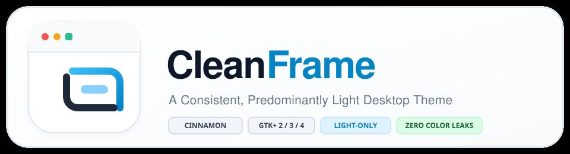
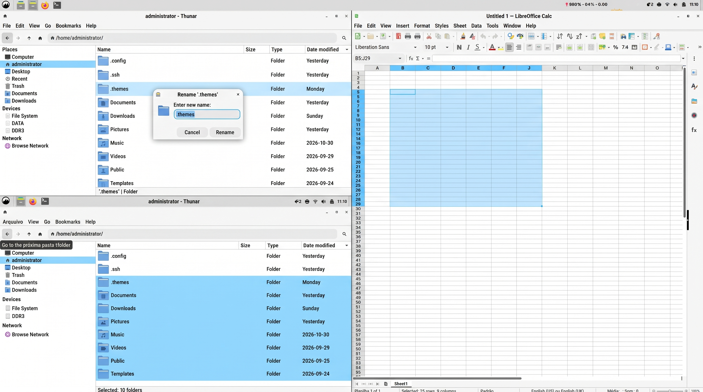
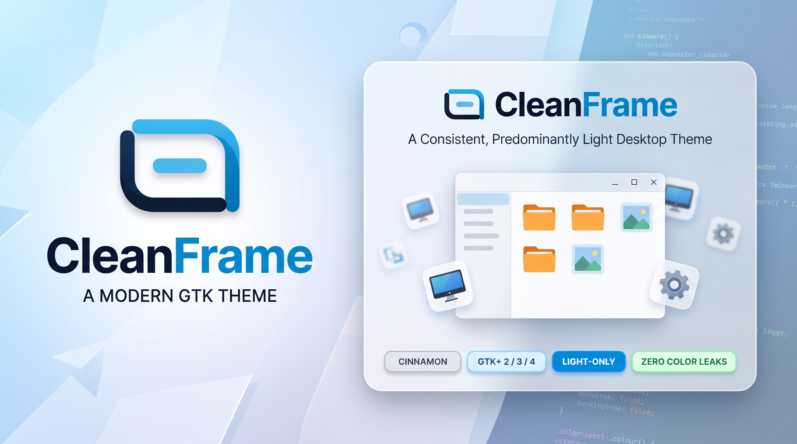
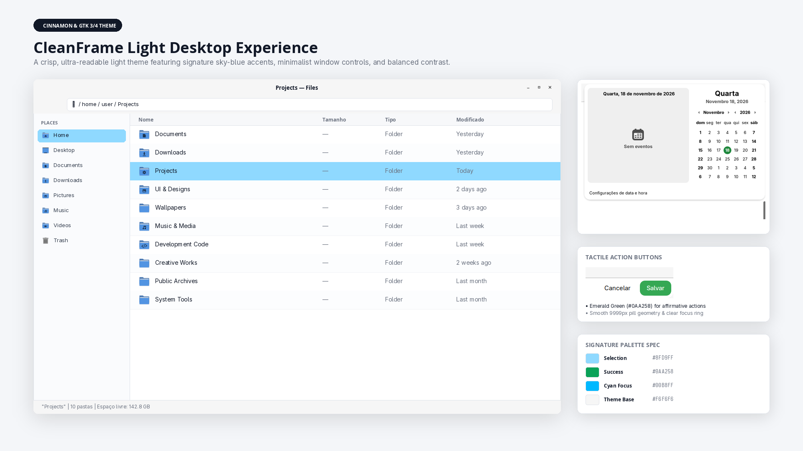
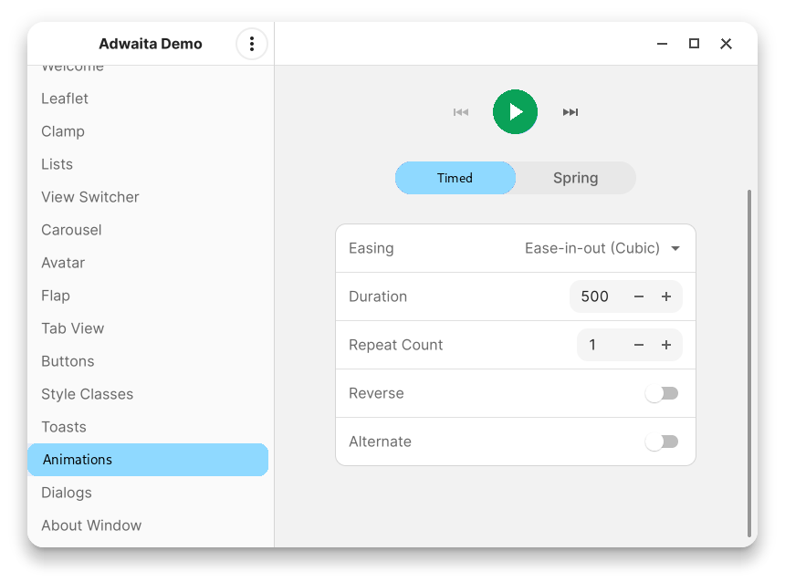

<p align="center">
  
</p>

<p align="center">
  <b><a href="README.md">🇺🇸 English</a></b> | <b>🇧🇷 Português</b>
</p>

# CleanFrame Theme

[](COPYING)
[](https://github.com/g00glelags/cleanframe/releases/latest)
[](https://www.opendesktop.org/p/2382045)
[](#principios)
[](#escopo)
[](#status-de-testes-e-ambientes)
[-blue.svg)](#distribuições-validadas)

CleanFrame é um tema **predominantemente light**, refinado com foco específico no **Cinnamon** e em todo o ecossistema **GTK+** (GTK 2, GTK 3 e GTK 4).

O objetivo do CleanFrame não é ser o tema "mais bonito" ou repleto de efeitos translúcidos e gradientes que cansam a visão no dia a dia. O foco absoluto é ser **confiável, ergonômico e nítido**: menus, popups, caixas de diálogo, seleções, entradas de texto, terminais e widgets devem permanecer legíveis, com contraste impecável e sem aberrações cromáticas (color leaks) no maior número de interfaces possível (GTK+, Cinnamon, Qt, Flatpak, Snap e apps Electron).

---

### Mantenedor / Links Oficiais:
- **Autor:** Marcos Sfair Mariani (`sfairmm`)
- **E-mail:** [g00gle.lags@gmail.com](mailto:g00gle.lags@gmail.com)
- **Telegram:** [@sfairmm](https://t.me/sfairmm)
- **OpenDesktop / Pling:** [https://www.opendesktop.org/p/2382045](https://www.opendesktop.org/p/2382045)
- **Repositório GitHub:** [https://github.com/g00glelags/cleanframe](https://github.com/g00glelags/cleanframe)
- **Espelho Codeberg:** [https://codeberg.org/g00gle_lags/cleanframe](https://codeberg.org/g00gle_lags/cleanframe)

---

## Prévia & Capturas de Tela

<p align="center">
  
</p>

<p align="center">
  
</p>

<p align="center">
  
</p>

<p align="center">
  
</p>

---

## Status de Testes e Ambientes (Transparência Comunitária)

Para garantir total clareza e transparência para a comunidade sobre o que foi validado na prática:

| Ambiente / Desktop | Nível de Teste | Situação & Observações |
| :--- | :--- | :--- |
| **Cinnamon** | 🟢 **Exaustivamente Testado** | **Ambiente principal do projeto.** Testado exaustivamente no uso diário. Painel, applets, menus clássicos e Cinnamon 6+ (`.appmenu-*`), barra lateral, calendário, alternador de janelas e CSD foram polidos em detalhes. |
| **XFCE** | 🟡 **Testado na parte GTK+** | Testado na camada de aplicações GTK+ e decorações de janela XFWM4. Comportamento estável e consistente. |
| **KDE Plasma** | 🟡 **Testado na parte GTK+** | Testado para garantir consistência em aplicativos GTK+ rodando sob a sessão Plasma (cores, fontes e seleção). |
| **GNOME (Shell)** | ⚪ **Nunca Testado** | **Atenção:** O tema **nunca foi testado no GNOME Shell pelo autor**. Embora a estrutura contenha código SCSS compilável herdado do upstream para GNOME Shell (40 a 49), seu comportamento visual no shell puro não é garantido. Contribuições e testes da comunidade são muito bem-vindos! |

### Distribuições Validadas

| Distribuição | Status | Observações |
| :--- | :--- | :--- |
| **CachyOS / Arch Linux** | 🟢 **100% Funcional** | Ambiente de desenvolvimento e testes diários (rolling release com versões recentes de pacotes). |
| **Linux Mint** | 🟢 **100% Funcional** | Ambiente de referência oficial para Cinnamon e todo o ecossistema GTK. |
| **Demais Distribuições** *(Fedora, Debian, Ubuntu, openSUSE, etc.)* | 🟡 **Provável que funcione** | Como o tema segue padrões universais de GTK 2/3/4 e Cinnamon, é muito provável que funcione perfeitamente, porém **ainda não foi homologado/testado** pelo autor. Relatos de testes e compatibilidade da comunidade são bem-vindos! |

---

## Princípios

- **Predominantemente light:** Foco absoluto no modo claro, sem inconsistências de texto claro em fundo claro.
- **Coerência visual acima de efeitos visuais:** Confiabilidade de interface em primeiro lugar.
- **Legibilidade e contraste como prioridade:** Menus e seleções sempre nítidos e fáceis de ler.
- **Fallback seguro:** Quando um app não herda o tema automaticamente, prover comportamento legível.
- **Integrações práticas documentadas:** Scripts dedicados para Qt, Flatpak, Snap, Terminais e Electron.

## Escopo

O repositório contém:

- Tema base (Cinnamon, GTK 2 / 3 / 4, XFWM4, Metacity)
- Scripts de integração e compatibilidade (Qt/GTK, Flatpak, Snap, Electron, terminais)
- Scripts de troubleshooting e ajustes finos (FileZilla wxWidgets, LibreOffice Calc dedicado)

## Instalacao Rapida

```bash
./install.sh
```

## Presets para Flatpak e Snap

O instalador pode aplicar presets de ambiente para melhorar a consistencia do
tema em apps sandbox.

```bash
# Flatpak (GTK_THEME + permissoes de leitura de tema/config)
./install.sh --flatpak

# Snap (gera preset em ~/.config/environment.d)
./install.sh --snap

# Ambos
./install.sh --sandbox
```

Observacoes:

- `--flatpak` usa `flatpak override --user`.
- `--snap` cria `~/.config/environment.d/90-cleanframe-theme.conf` com `GTK_THEME=CleanFrame-Light`.
- No Snap, pode ser necessario encerrar sessao e entrar novamente para o ambiente propagar.

## Integracoes Comunitarias (Qt / Flatpak / Electron)

Para aproximar a coerencia visual em apps que nao seguem GTK automaticamente:

```bash
bash scripts/apply-community-integrations.sh
```

Exemplos:

```bash
# Apenas Qt/GTK (sem instalar pacotes)
bash scripts/apply-community-integrations.sh --qt

# Apenas CSS de selecao para wrappers Electron
bash scripts/apply-community-integrations.sh --electron

# Gerar CSS para todos os presets conhecidos do script Electron
bash scripts/apply-community-integrations.sh --electron --electron-all-known

# Habilitar injecao de CSS no Slack (normal + Flatpak), quando suportado
bash scripts/apply-community-integrations.sh --slack-interop
```

Importante:

- Apps Electron (Slack/Teams/wrappers) normalmente nao herdam a selecao GTK do conteudo web.
- O CleanFrame gera CSS de selecao, mas o app precisa suportar custom CSS / injecao.
- `teams-for-linux` costuma suportar `custom.css`; Slack pode exigir `ssb-interop.js`.

## Limites Conhecidos (Importante para suporte)

- Qt precisa de sessao com variaveis de ambiente carregadas (`~/.config/environment.d`), geralmente apos logout/login.
- Flatpak pode exigir override e permissao de leitura do tema/config.
- Electron depende de suporte da versao/build para custom CSS ou preload interop.
- Nem todo widget interno de app proprietario respeita o tema do sistema.

## Variante Dedicada para LibreOffice Calc

Para manter a selecao geral do sistema e usar outra cor apenas no Calc:

```bash
# 1) instale/atualize o tema base
./install.sh

# 2) gere a variante CleanFrame-Light-Calc (selecao #00b8ff)
./scripts/install-calc-theme-variant.sh

# 3) abra o Calc forcando a variante
./scripts/run-calc-with-theme.sh
```

Opcional:

```bash
CALC_SELECTION_BG='#00b8ff' ./scripts/install-calc-theme-variant.sh
```

## FileZilla (Modo Seguro)

Se o FileZilla apresentar bug visual (drop target preto / renomear deformado),
rode com launcher isolado:

```bash
./scripts/run-filezilla-safe.sh
```

Opcional (testar com seu tema atual):

```bash
FILEZILLA_GTK_THEME='CleanFrame-Light' ./scripts/run-filezilla-safe.sh
```

## Empacotamento e Build para Distribuição Comunitária

Para gerar o build do tema e criar os arquivos compactados prontos para distribuição comunitária (GitHub Releases, Gnome-Look / Pling):

```bash
# Compilar tema montado em build/
make build

# Gerar pacotes de distribuição (.tar.xz e .zip) em dist/
make package
```

## Release Comunitária

Documentos de referência para testes, validação e licenciamento:

- `CREDITS.md` - Atribuições e créditos completos
- `COPYING` - Licença GNU General Public License v3.0
- `docs/TEST_MATRIX.md` - Matriz de testes em GTK, Cinnamon e Shell
- `docs/RELEASE_CHECKLIST.md` - Checklist pré-release
- `docs/LICENSE_AND_CREDITS.md` - Conformidade de licenciamento e upstream

## Licença e Créditos

CleanFrame é um software livre distribuído sob a licença **GNU General Public License v3.0 (GPL-3.0)**.

O projeto é mantido por **sfairmm** ([g00gle.lags@gmail.com](mailto:g00gle.lags@gmail.com)) e deriva respeitosamente de grandes trabalhos da comunidade:
- **Orchis Theme** por Vince Liuice ([@vinceliuice](https://github.com/vinceliuice))
- **Materia Theme** por nana-4 ([@nana-4](https://github.com/nana-4))
- **Firefox GNOME Theme** por Rafael Mardojai e Sai Kurogetsu
- **Adwaita / GNOME Shell** por GNOME Design Team / Red Hat, Inc.

### Assistência de Ferramentas de IA / AI Assistance

O desenvolvimento e refinamento do CleanFrame contaram com o auxílio de modelos de Inteligência Artificial:
- **Codex (OpenAI)** em **2025**: Apoio na estruturação inicial do fork, limpeza das primeiras regras dark e adaptações do SCSS para o modo claro unificado.
- **Gemini (Google DeepMind)** em **2026**: Apoio na estabilização do pipeline de build, engenharia de normalização GTK4 CSS (GNOME Shell 40–49), automação de auditorias visuais, scripts de integração (Flatpak/Snap/Terminal/Electron) e empacotamento para lançamento comunitário.

Veja a lista completa de contribuições e notas legais em [CREDITS.md](CREDITS.md) e [COPYING](COPYING).
